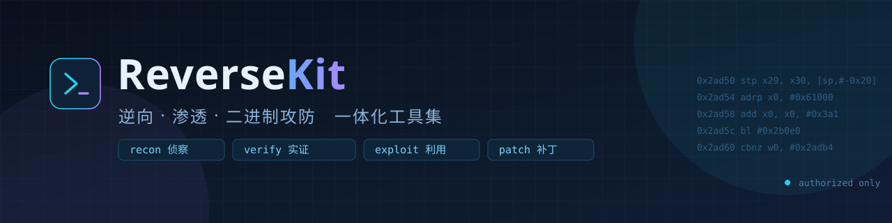
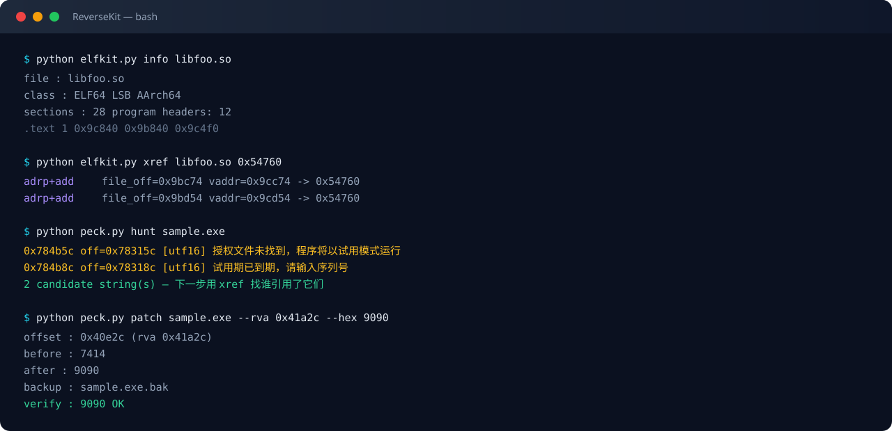

<div align="center">
  
</div>

<p align="center">
  <a href="LICENSE"></a>
  <a href="https://github.com/guodongshang91-beep/ReverseKit/actions/workflows/ci.yml"></a>
  <a href="https://www.python.org/"></a>
  
  
  
  <a href="CONTRIBUTING.md"></a>
  
</p>

<h3 align="center">不产出「疑似漏洞」，只产出「能复现的证据」</h3>

<p align="center">
  <b>ReverseKit</b> 把散落在实战里的侦察、验证、二进制分析与定点补丁，收成一套能一条命令跑完、
  每一步都留原始回显的工具链。六个模块互相独立，也串成完整链路。
</p>

<p align="center">
  <a href="#快速开始">快速开始</a> ·
  <a href="#模块速览">模块速览</a> ·
  <a href="#演示">演示</a> ·
  <a href="#核心方法论五道假阳性防线">方法论</a> ·
  <a href="docs/">完整文档</a> ·
  <a href="CONTRIBUTING.md">贡献指南</a>
</p>

---

<details>
<summary><b>目录</b>（点开）</summary>

- [为什么会有这个仓库](#为什么会有这个仓库)
- [模块速览](#模块速览)
- [快速开始](#快速开始)
- [演示](#演示)
- [核心方法论：五道假阳性防线](#核心方法论五道假阳性防线)
- [项目结构](#项目结构)
- [典型场景](#典型场景)
- [设计原则](#设计原则)
- [路线图](#路线图)
- [贡献](#贡献)
- [许可证与免责声明](#许可证与免责声明)

文档：[快速开始](docs/00-quickstart.md) · [架构](docs/01-architecture.md) · [安装](docs/02-install.md) ·
[模块手册](docs/03-modules.md) · [假阳性方法论](docs/04-false-positive.md) ·
[实战 Playbook](docs/05-playbooks.md) · [合规边界](docs/06-legal.md) · [FAQ](docs/07-faq.md)

</details>

---

## 介绍视频

[](https://github.com/guodongshang91-beep/ReverseKit/releases/download/v1.1.0/ReverseKit-intro.mp4)

85 秒讲完一条链：三层结构 · 六个模块 · 五道假阳性防线 · 二进制定点补丁。

- [**1080p 正片（85s）**](https://github.com/guodongshang91-beep/ReverseKit/releases/download/v1.1.0/ReverseKit-intro.mp4)
- [无声预览 GIF](https://github.com/guodongshang91-beep/ReverseKit/releases/download/v1.1.0/intro-preview.gif) · [封面帧](https://github.com/guodongshang91-beep/ReverseKit/releases/download/v1.1.0/poster.jpg)

---

## 为什么会有这个仓库

工具不缺。缺的是**「命中之后怎么办」**。

| 痛点 | 通常的结果 | ReverseKit 的做法 |
| --- | --- | --- |
| 扫描器一次吐出几百条"高危"，逐条人工核对到崩溃 | 报告里塞满假阳性，信用一次性耗尽 | **五道假阳性防线**内建在扫描脚本里，软 404 / WAF 拦截页 / 错误回显当场判死 |
| 工具链装不上（GitHub Releases 直连超时、镜像回 zip 不回的 HTML） | 卡在环境上，一天没了 | 核心脚本**零重型依赖**，纯标准库 + `requests` 就能跑 |
| 漏洞只在报告里"可能存在"，复现时对不上 | 被打回、降级、忽略 | 每条结论强制附**原始请求/响应 + 两次独立会话复现** |
| 二进制分析要 IDA/Ghidra，脚本化不了 | 结论无法复现、无法交接 | `elfkit` / `peck` 用 capstone + pefile **脚本化**整条链路 |
| 实战经验散在一堆一次性脚本里 | 下次从零开始 | 全部收敛成有参数、有校验、有文档的子命令 |

一句话：**把「我觉得有洞」变成「这是报文，你自己跑一遍」。**

---

## 模块速览

| 模块 | 定位 | 代表工具 | 典型产出 |
| --- | --- | --- | --- |
| [`web-recon`](modules/web-recon/) | 黑盒 Web 快速侦察 | `dnsx` `probe` `jsonp_fuzz` `headers_check` | 存活面、软 404 基线、可注入回调 |
| [`src-hunt`](modules/src-hunt/) | SRC 广撒网 + 假阳性过滤 | `recon` `unauth_scan` `js_harvest` `param_probe` | 已验证的未授权 / 敏感文件 / 密钥泄露 |
| [`binary-re`](modules/binary-re/) | ELF / `.so` 静态分析 | `elfkit info\|strings\|xref\|dis\|patch` | 引用链、判定点、可回滚补丁 |
| [`pe-patch`](modules/pe-patch/) | Windows PE 授权校验分析 | `peck info\|hunt\|xref\|dis\|patch` | 授权检查路标、最小侵入补丁 |
| [`wifi`](modules/wifi/) | WPA2 握手抓取与校验 | `capture` `analyze` `gen_dict` | 22000 格式握手、PMK→MIC 自检 |
| [`android`](modules/android/) | 免 root 触摸注入选型 | `aar_extract` `res_check` `syntax_check` | 路线对比（A–F）、工程静态自检 |

---

## 快速开始

```bash
git clone https://github.com/guodongshang91-beep/ReverseKit.git
cd ReverseKit
pip install -r requirements.txt          # requests / dnspython / capstone / pefile
```

三条命令看效果：

```bash
# 1) 域名侦察：DNS 记录里找内网泄露与接管面
python modules/web-recon/src/dnsx.py example.com

# 2) 整条链路一条命令（recon → probe → unauth/oss/js/param/targeted）
python modules/src-hunt/rkhunt.py run --scope examples/scope.csv --dry-run   # 先看计划
python modules/src-hunt/rkhunt.py run --scope scope.csv --workers 24
python modules/src-hunt/rkhunt.py status                                    # 看产物与计数

# 3) 二进制：字符串 → 交叉引用，一条链走到位
python modules/binary-re/tools/elfkit.py strings libfoo.so -m 6 -f licen
python modules/binary-re/tools/elfkit.py xref   libfoo.so 0x2a1c0

# 4) PE：授权检查关键词狩猎
python modules/pe-patch/tools/peck.py hunt app.exe
```

> 所有脚本都支持 `-h`。参数、输出字段、退出码在各模块 README 里写死了，照抄即可。

---

## 演示

<div align="center">
  
</div>

真实回显（在 `libc++_shared.so` 与一个 64 位 PE 上实测）：

```text
$ python elfkit.py info libc++_shared.so
class     : ELF64  LSB  AArch64
sections  : 28   program headers: 12
  .text   1   0x9c840   0x9b840   0x9c4f0

$ python elfkit.py xref libc++_shared.so 0x54760
  adrp+add  file_off=0x9bc74   vaddr=0x9cc74  -> 0x54760
  adrp+add  file_off=0x9bd54   vaddr=0x9cd54  -> 0x54760

$ python peck.py hunt app.exe
0x784b5c  off=0x78315c  [utf16] 授权文件未找到，程序将以试用模式运行
0x784b8c  off=0x78318c  [utf16] 试用期已到期，请输入序列号
2 candidate string(s) — 下一步用 xref 找谁引用了它们
```

`xref` 认的不是"扫到个地址"，是 **AArch64 的 `adrp Xn, #page` + `add Xn, Xn, #lo12` 指令对**——
页基址加页内偏移凑出目标地址，才叫真引用。x86/x64 走指针字面量扫描。两条路都验证过。

---

## 核心方法论：五道假阳性防线

这是本仓库最值钱的部分，比任何单个脚本都值钱。**大厂站点上"命中"几乎全是假的**，
这五条是拿一遍遍推翻自己换来的：

| # | 防线 | 拦的是什么 | 落地实现 |
| --- | --- | --- | --- |
| 1 | **随机路径基线** | 站点对所有路径返回同一页（SPA 兜底 / WAF 兜底 / 统一错误页） | 先 `GET /<random>-probe`，200 即 catch-all；命中须与基线 md5/长度显著不同 |
| 2 | **收紧正则** | 拿 `title` / `h2` / `loading` 这类 HTML 通用词当特征 | 只匹配组件独有串（`/h2-console` 曾因正文有 `<h2>` 被判高危） |
| 3 | **响应去重** | 同一主机多个路径返回同一 md5 | 按 md5 去重，同组只留等级最高的一条 |
| 4 | **WAF 拦截页** | 200 但正文是拦截页 | 匹配 `waf_block` `/punish/` `__waf` `访问被拒绝` `deny.html`… |
| 5 | **404 路径回显** | 404 正文把请求路径原样回显，命中的是路径本身 | 判 `path 末段 in txt_head` |

还有一条附带的坑：`allow_redirects=True` 会把 **`redirect_uri` 里的字符串也算命中**
（`/debug/` 302 到 OIDC 登录页，结果命中了 `%2Fdebug%2F`）。
针对性探测必须 `allow_redirects=False`，且不匹配重定向目标 URL。

实测效果：某大厂门户上 5 条"中高危" → **0**；全量扫描识别出 **232 个 catch-all 站点**。
细节见 [docs/04-false-positive.md](docs/04-false-positive.md)。

---

## 项目结构

```text
ReverseKit/
├── modules/
│   ├── web-recon/           # 黑盒侦察：DNS / 存活 / 软404 / JSONP / 响应头
│   │   └── src/{dnsx,probe,jsonp_fuzz,headers_check}.py
│   ├── src-hunt/            # 广撒网 + 假阳性过滤
│   │   ├── rkhunt.py        # 全链路编排器（run / status / list）
│   │   └── src/{recon,probe,unauth_scan,oss_scan,js_harvest,param_probe,targeted,targets,dsstore_parse}.py
│   ├── binary-re/           # ELF/.so 静态分析
│   │   └── tools/elfkit.py
│   ├── pe-patch/            # PE 授权校验分析
│   │   └── tools/peck.py
│   ├── wifi/                # WPA2 握手抓取 / 校验 / 字典
│   │   └── src/{capture,capture_mon,analyze,gen_dict}.py
│   └── android/             # 免 root 注入选型与工程自检
│       └── tools/{aar_extract,res_check,syntax_check}.py
├── tools/
│   └── evidkit.py           # 证据包（new/add/seal/verify）+ 报告渲染（report）
├── docs/                    # 快速开始 / 架构 / 安装 / 模块手册 / 方法论 / 实战 / 合规 / FAQ
├── examples/                # 可直接跑的输入样例（全部为占位目标）
├── assets/                  # banner / 架构图 / 演示图
├── requirements.txt
├── check.py                 # 本地自检：编译 / CLI 冒烟 / 真实资产守卫 / pyflakes
├── LICENSE                  # MIT
├── DISCLAIMER.md            # 免责声明与合法用途
└── CONTRIBUTING.md
```

架构图见 [assets/architecture.svg](assets/architecture.svg)，分层说明见 [docs/01-architecture.md](docs/01-architecture.md)。

---

## 典型场景

<table>
<tr><td width="33%" valign="top">

**① SRC 挖洞（授权范围内）**

子域枚举 → 指纹识别 → 未授权路径 → JS bundle 挖内部地址 →
逐项复现 → 出证据包。链路在 `src-hunt`，
实战记录见 [docs/05-playbooks.md](docs/05-playbooks.md#playbook-1src-从-0-到中高危)。

</td><td width="33%" valign="top">

**② 授权渗透 / 内网打点**

软 404 基线先立起来，再谈爆破——
否则几百条"命中"里没一条是真的。
JSONP 回调注入用 `jsonp_fuzz`，
执行在攻击者 origin 还是目标 origin 要分清楚。

</td><td width="33%" valign="top">

**③ 二进制 / 授权机制分析**

自有软件或获授权样本：
`peck hunt` 找路标 → `xref` 找引用 →
`dis` 看判定 → `patch` 最小改动 →
回读校验 + 备份可回滚。

</td></tr>
<tr><td valign="top">

**④ 移动端自动化研究**

免 root 只有两条路（无障碍 `dispatchGesture` /
USB HID 触摸屏），要 root 的还有四条。
反检测强度、暴露面、可移植性对比在
[`modules/android`](modules/android/)。

</td><td valign="top">

**⑤ 无线安全自查**

用错误密钥主动连自己的 AP 触发四次握手，
不依赖监听模式、不需要第二块网卡。
`analyze` 自带合成自检，先证明管线对，再谈真实抓包。

</td><td valign="top">

**⑥ 当复盘材料用**

每个模块都记了"踩过什么坑、为什么这么改"。
假阳性防线、Ghidra `.sla` 版本坑、
`wmic` 被策略禁用后的替代路径——都在文档里。

</td></tr>
</table>

---

## 设计原则

1. **可复现优先**：任何结论都要能贴出原始回显。没跑通的步骤写"未执行"，不写"应该"。
2. **最小影响**：只读探测优先；`heapdump` / 备份包只取头部证明真实，不整包下载；不上传、不删改。
3. **零重型依赖**：核心链路纯标准库 + `requests`；`capstone` / `pefile` 只在二进制模块用到。
4. **原生命令行**：每个工具都是独立可执行脚本，不绑定框架、不要求 Agent 环境。
5. **边界写在明面上**：反推的标注反推，实测的标注实测，示意图不当测绘成果用。

---

## 路线图

- [x] 六个模块骨架 + 统一 CLI 风格
- [x] 假阳性五道防线固化为可复用实现
- [x] `elfkit` / `peck` 双端二进制工具
- [x] `src-hunt` 全链路一键编排（`rkhunt run --scope scope.csv`）
- [x] 证据包自动归档（`evidkit new/add/seal/verify`，sha256 清单）
- [x] 报告模板生成（`evidkit report`，从 meta.json + 抓包渲染）
- [x] 栈指纹扩到 57 条（Nacos 2.x / MinIO / K8s Dashboard / Harbor / Consul / XXL-JOB…）
- [ ] 平台表单字段映射（把报告直接填成提交表单）
- [ ] 被动流量分析（从已有 pcap 反推资产，不主动发包）

---

## 贡献

欢迎 PR。提交前跑一遍自检：

```bash
python check.py          # 编译 + CLI 冒烟 + 真实资产守卫 + pyflakes
```

四道检查有一项失败就退出 `1`：编译不过 / 工具 `-h` 崩 / 仓库里混进真实厂商域名或凭据 /
静态检查有提示（最后一项只提示）。不依赖 GitHub Actions，本地跑就够。

约定：脚本必须能 `-h` 自解释；不得内置任何真实厂商域名或他人资产；
新增检测项必须同时给出**假阳性防线**。详见 [CONTRIBUTING.md](CONTRIBUTING.md)。

---

## 许可证与免责声明

本项目以 **MIT** 许可发布，见 [LICENSE](LICENSE)。

> ⚠️ **ReverseKit 仅用于合法授权的安全测试、自有软件分析、教学与研究。**
> 使用前请确认你对目标拥有书面授权或所有权。未经授权对他人系统进行扫描、渗透、破解，
> 在绝大多数司法辖区属违法行为，责任由使用者自行承担。
> 完整条款见 [DISCLAIMER.md](DISCLAIMER.md) 与 [docs/06-legal.md](docs/06-legal.md)。

<p align="center">
  <sub>Built for people who would rather show the packet than argue about it.</sub>
</p>
