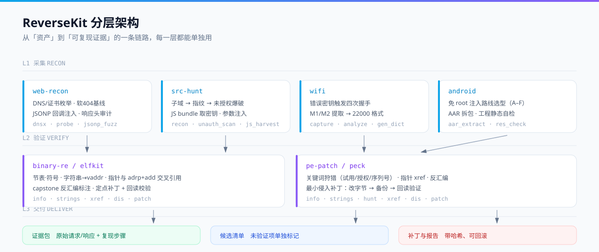

# 架构

## 三层结构

```text
L1 采集  ── web-recon · src-hunt · wifi · android
              ↓ 原始数据（json / pcap / 字节流）
L2 验证  ── 假阳性防线 · elfkit · peck
              ↓ 只剩"能复现的"
L3 交付  ── 证据包 · 候选清单 · 补丁与报告
```

<div align="center">
  
</div>

## 为什么要分层

三个理由，都是踩出来的：

1. **采集和验证必须分开。** 采集阶段追求覆盖率（多打、多猜），验证阶段追求准确率
   （宁可少报，不可错报）。混在一起的结果就是"扫了一堆，一条都不敢写"。
2. **每层都能单独退出。** 只想做资产测绘？L1 跑完就停。只想判一条漏洞真伪？
   直接进 L2 手工验证，不用跑全链路。
3. **数据格式统一，层与层之间靠文件解耦。** 上游换成别的扫描器也行，
   只要吐出 `[{host, status, stack}]` 就能接上 `unauth_scan`。

## 数据流

```text
targets.csv
   │  recon.py
   ▼
subs.json ── probe.py ──▶ alive.json ──┬─ unauth_scan.py ─▶ unauth.json
                                       ├─ js_harvest.py  ─▶ js.json
                                       ├─ param_probe.py ─▶ param.json
                                       └─ targeted.py    ─▶ targeted.json
                                                              │
                                             人工复现 + 证据归档
                                                              ▼
                                                     evidence/<ID>/
```

二进制侧是单线程的：

```text
样本 ── info（结构）── strings（路标）── xref（引用）── dis（判定）── patch（改）
                                                                      │
                                                          回读校验 + .bak
```

## 模块间不共享代码，只共享约定

刻意的选择：每个脚本都能被单独 `curl` 下来就跑，不装包、不改 import 路径。
代价是少量重复代码（比如 UA 常量、hx() 格式化），收益是**任何一个脚本坏了不影响其他**。

## 扩展点

| 想加什么 | 改哪里 |
| --- | --- |
| 新的系统指纹 | `src-hunt/src/probe.py` 的指纹表 |
| 新的未授权探测路径 | `src-hunt/src/unauth_scan.py` 的 `SIGS`（**必须同时写防线**） |
| 新的栈专属 payload | `src-hunt/src/targeted.py` 的 `STACK_SIGS` |
| 新的二进制架构 | `binary-re/tools/elfkit.py` 的 `EM` 表 + `cmd_dis` 的 arch 映射 |
| 新的 PE 关键词 | `pe-patch/tools/peck.py` 的 `KEYWORDS` |
